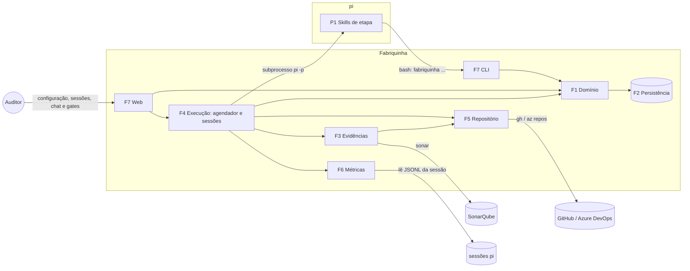

# Fabriquinha — Visão geral

Fonte: `LocalIssues/ProcessoDeDesenvolvimento.drawio` (versão de 2026-10-11, quadro "SDLC tradicional").
Este documento fixa o escopo, os sistemas, os módulos e as decisões transversais.
Cada módulo tem a sua própria spec, listada no fim.

## 1. Objetivo

Executar o SDLC do diagrama com agentes pi, com um humano (o Auditor) nos gates de decisão.
A Fabriquinha substitui o issues-local e passa a ser a fonte da verdade do processo: estado, evidências, decisões e métricas.

## 2. Versão final do processo

### 2.1 O que mudou desde a primeira versão do diagrama

- RevisarSolucao ganhou três evidências: comprovação dos critérios de aceite (vídeos/imagens), relatório de arquivos alterados × desenho inicial e matriz de fitness functions com explicações.
- RevisarSolucao ganhou a métrica "quantidade de bugs em arquivos revisados".
- O diagrama inteiro está num quadro "SDLC tradicional"; esta spec trata só desse fluxo.
- Decidido no alinhamento das evidências (ainda não está no diagrama): DesenharSolucao ganha o "Relatório de Impactos na Arquitetura", e o "Relatório de Análise de Complexidade" passa a registrar complexidade algorítmica de tempo e espaço.
- Decidido em 2026-10-15 (D11, ainda não está no diagrama): o Auditor constrói o registro e o desenho junto com a IA; o vídeo explicativo deu lugar à aula do código e ao vídeo de demonstração.

### 2.2 Etapas

| Etapa | Gatilho | Executor | Evidências | Métricas | Saída |
|---|---|---|---|---|---|
| RegistrarNecessidade | Auditor | pi interativo + Auditor | vídeo e/ou código do comportamento; critérios de aceite | tokens e custo por modelo; correções do Auditor | Issue + Ticket de Desenho |
| DesenharSolucao | Cron/Timer (agendador da Fabriquinha) ou Auditor | pi interativo + Auditor | desenho da solução; protótipo + vídeo/print (só funcionalidade); relatório de análise de complexidade (tempo e espaço); relatório de impactos na arquitetura | tokens e custo; correções no desenho | gate do Auditor → Tickets de Desenvolvimento |
| ImplementarSolucao | Loop | pi autônomo | execução dos testes (todos passando); relatório do SonarQube | tokens e custo; alterações posteriores no código | próximo Ticket de Desenvolvimento ou Ticket de Revisão |
| RevisarSolucao | Ticket de Revisão | pi autônomo | comprovação dos critérios de aceite; arquivos alterados × desenho; matriz de fitness functions | tokens e custo; exigências de alteração; bugs em arquivos revisados | Reprovado → Loop; Aprovado → Ticket de Encerramento |
| EncerrarSolucao | Ticket de Encerramento | pi autônomo | mensagem do PR; PR aberto; aula do código; vídeo de demonstração (só quando a mudança aparece no cliente); relatório de produtividade do SDLC; dados no banco local | tokens e custo; nota do Auditor | Pull Request → gate do Auditor |
| Sessão em aberto | PR reprovado | pi interativo, sem skill de etapa | — | tokens e custo | Loop → Tickets de Desenvolvimento |

### 2.3 Gates

| Gate | Quem decide | Aprovado | Reprovado |
|---|---|---|---|
| Registro | Auditor, na página da issue, depois que a IA envia (com o "sim" dele na conversa) | Ticket de Desenho é criado | o motivo volta à mesma sessão de registro |
| Desenho | Auditor, na página da issue, depois que a IA envia (com o "sim" dele na conversa) | Tickets de Desenvolvimento liberados | o motivo volta à mesma sessão de desenho |
| Revisão | agente revisor | Ticket de Encerramento | novos Tickets de Desenvolvimento com as exigências |
| PR | Auditor, com nota | merge; o CI/CD segue fora da Fabriquinha | Sessão em aberto |

### 2.4 Leituras do diagrama que esta spec assume

- "Periodicamente → Auditor" é a cadência do humano, não uma função do sistema.
- "CI/CD → Demanda" significa que falhas e pedidos vindos do CI/CD voltam como novas demandas registradas pelo Auditor.
- "Auditor → Ticket de Desenvolvimento" significa que, no gate de desenho, o Auditor pode ajustar os tickets propostos pelo desenho antes de aprovar.
- "ImplementarSolucao → Loop" significa que, enquanto houver Ticket de Desenvolvimento aberto na issue, o próximo é executado; quando não houver, nasce o Ticket de Revisão.
- "Dados do trabalho (registro em banco de dados local)" é o próprio banco da Fabriquinha.

### 2.5 Fora de escopo

- O CI/CD em si: a Fabriquinha só faz o merge do PR aprovado.
- Sugestões da análise anterior que não entraram no diagrama: testes *holdout*, orçamento do loop, gate de desenho condicionado a HITL/AFK e baseline do processo atual.
- Migração do `db.json` do issues-local: a Fabriquinha começa vazia.
- Recursos do issues-local que não seguem: rótulo HITL/AFK, anexos UML, exclusão de issue, Limpar CLOSED (substituído por arquivar) e dependência entre tickets (substituída pela ordem de criação).

## 3. Sistemas

| Sistema | Papel |
|---|---|
| **Fabriquinha** | Fonte da verdade do processo. Guarda estado, evidências, decisões e métricas. Despacha execuções, produz as evidências determinísticas, aplica os gates e abre o PR. |
| **pi** | Executor das sessões de agente. Não guarda estado de processo. Recebe uma etapa por sessão por meio de uma skill. |
| Externos | git (worktree, commits), `gh` e `az repos` (PR e merge), `sonar` (SonarQube CLI), serviço de usuário do systemd (só mantém a Fabriquinha de pé), CI/CD do repositório. |

## 4. Princípios de desenho

1. **A Fabriquinha é a fonte da verdade; o pi é só executor.**
   O agente consulta e registra pelo CLI da Fabriquinha; nenhum estado de processo vive no pi.
2. **Evidência verificável por máquina é produzida pela Fabriquinha, nunca declarada pelo agente.**
   Testes, SonarQube, arquivos alterados, fitness functions, PR e relatório de produtividade são gerados pela Fabriquinha.
   O agente produz só o que exige julgamento: desenho, critérios, vídeos, explicações e mensagem do PR.
3. **Gates humanos ficam fora do alcance do agente.**
   O agente tem bash; se o CLI expusesse "aprovar", ele poderia aprovar o próprio trabalho.
4. **Uma execução = um ticket = uma sessão pi.**
   A sessão termina quando o ticket termina; quem decide o próximo passo é o agendador da Fabriquinha (Feedback.txt, item 4).
5. **O agente só mexe no próprio ticket.**
   A Fabriquinha passa o ticket por variável de ambiente, e o CLI recusa mutações fora dele.
6. **Formato de evidência tem uma definição só.**
   O mesmo schema gera o tipo, valida a submissão e vai para a skill como JSON Schema (Feedback.txt, item 1).
7. **Uma issue = uma worktree = uma branch = um PR.**
8. **Cada conteúdo no formato da sua finalidade.**
   Explicação para humano em HTML; passagem de contexto entre agentes em Markdown ou texto; dado que a máquina confere em JSON.

## 5. Módulos

| Sistema | Módulo | Responsabilidade | Spec |
|---|---|---|---|
| Fabriquinha | F1 Domínio | Entidades, máquina de estados do SDLC, regras de transição, schemas e validações. Sem I/O. | `fabriquinha/01-dominio.md` |
| Fabriquinha | F2 Persistência | Banco SQLite (schema, constraints, transações) e armazenamento dos arquivos de evidência. | `fabriquinha/02-persistencia.md` |
| Fabriquinha | F3 Evidências | Catálogo de evidências por etapa, coletores determinísticos, validação do que o agente submete e completude de cada gate. | `fabriquinha/03-evidencias.md` |
| Fabriquinha | F4 Execução | Serviço de longa duração: agendador interno, gerente de sessões do pi (modo RPC), sessões interativas e retomada após reinício. | `fabriquinha/04-execucao.md` |
| Fabriquinha | F5 Repositório | Worktree e branch por issue, commit por ticket, diff contra a base, PR, merge e limpeza. | `fabriquinha/05-repositorio.md` |
| Fabriquinha | F6 Métricas | Uso de tokens e custo por execução, métricas do diagrama, relatório de produtividade. | `fabriquinha/06-metricas.md` |
| Fabriquinha | F7 Interfaces | CLI do agente; web do Auditor com board, sessões e chat, evidências, gates, métricas e configuração. | `fabriquinha/07-interfaces.md` |
| Fabriquinha | F8 Simulação | Usuários Simulados por projeto, com anexos, que a IA imita para achar problemas de usabilidade e bugs no produto. | `fabriquinha/08-simulacao.md` |
| pi | P1 Pacote `pi-fabriquinha` | Instruções de cada etapa, a skill com o CLI e os formatos (usada também na sessão em aberto) e a extensão `guarda`, que impede o agente de criar PR. | `pi/01-pacote-skills.md` |
| pi | P2 Gravação de evidências | Skills/tools para o agente gravar vídeo e capturar imagem por tipo de projeto. Em exploração pelo Auditor. | `pi/02-gravacao-evidencias.md` (a definir) |

A Fabriquinha não desliga nada do pi do Auditor: settings, skills, extensões e ferramentas dele valem nas execuções (F4, 6.1).
Ela só soma o pacote P1.

## 6. Decisões tomadas (revisáveis)

| # | Decisão | Motivo | Alternativa descartada |
|---|---|---|---|
| D1 | SQLite via `node:sqlite`, embutido no Node ≥ 22.13 | Agendador, web e agentes escrevem ao mesmo tempo; métricas viram consultas SQL; constraints ficam no banco. | `db.json` com lock de diretório |
| D2 | `zod` como fonte única dos schemas | Um schema gera o tipo, valida em runtime e exporta o JSON Schema para a skill. | Validação escrita à mão |
| D3 | pi como subprocesso em modo RPC: `pi --mode rpc --session-dir … --session-id …` | Permite conversar, redirecionar, abortar e responder diálogos pelo web; falha isolada; sessão num caminho conhecido para as métricas. | `pi -p --mode json` (sem interação); SDK do pi no mesmo processo |
| D4 | A Fabriquinha faz o commit ao fim de cada Ticket de Desenvolvimento aprovado no gate | Commit = estado verificado; vínculo commit ↔ ticket; mensagem padronizada. | O agente faz o commit |
| D5 | PR no GitHub (`gh`) e no Azure DevOps (`az repos`), merge com merge commit | Os dois hospedam os projetos; o merge commit preserva os commits por ticket na branch base. | Squash; um provedor só |
| D6 | Quality gate do SonarQube reprovado barra o Ticket de Desenvolvimento | Mesma regra da sua skill `commit`. | Só anexar o relatório |
| D7 | Execução que falha (crash, timeout, evidência faltando) leva o ticket a `falhou` e espera o Auditor | Evita que o agendador repita a mesma falha e queime tokens a cada ciclo. | Nova tentativa automática |
| D8 | Uma execução autônoma por issue, em paralelo (revista: antes era uma por vez, global) | Issues diferentes não disputam nada no domínio; dentro da issue continua uma execução por vez. | Limite de execuções simultâneas |
| D9 | Toda operação do Auditor (configuração, registro, sessões, gates) fica no web, com token gerado na subida do serviço; o CLI é só do agente, mais `servidor` e `abrir` | O CLI não tem comando de Auditor que o agente possa chamar. | Gates e sessões pelo terminal |
| D10 | A Fabriquinha roda como um serviço único, com agendador interno ligado e calibrado pelo web; a porta é a trava de instância única | O agendamento faz parte do produto e é configurado pelo Auditor; o sistema operacional só mantém o serviço de pé. | cron chamando `fabriquinha tick` |
| D11 | Registro e desenho são conversas: a IA questiona, leva cada decisão relevante ao Auditor e só envia à aprovação (C25) com o "sim" dele; devolver volta à mesma sessão. No PR, a aula do código explica a lógica de cada trecho alterado, e o vídeo, só de demonstração pelo cliente, existe quando há frontend | Artefatos feitos sem o Auditor chegavam sem contexto e eram aprovados sem leitura; o vídeo mostrava o resultado, não a lógica | Desenho autônomo com gate só no fim; vídeo explicativo do código; handoff de sessão (fora: a compactação do pi basta por ora) |

## 7. Pendências resolvidas

- **Q1:** não migrar o `db.json`; a Fabriquinha começa vazia.
- **Q2:** do issues-local, seguem só a dependência entre issues e o arquivamento de issues concluídas.
  Arquivada guarda todos os dados, some do board e continua acessível por uma opção explícita no web.
- **Q3:** PR no GitHub e no Azure DevOps (D5).
- **Q4:** gravar vídeo e capturar imagem vira o módulo P2 do pi, ainda em exploração.
  Até lá, as specs tratam vídeo e imagem como arquivos que o agente anexa à evidência.

## 8. Ordem das specs

F1 → F2 → F3 → F4 → F5 → F6 → F7 → F8 → P1 → P2 (quando a exploração terminar).
O domínio vem primeiro porque todos os outros módulos dependem das suas entidades.
