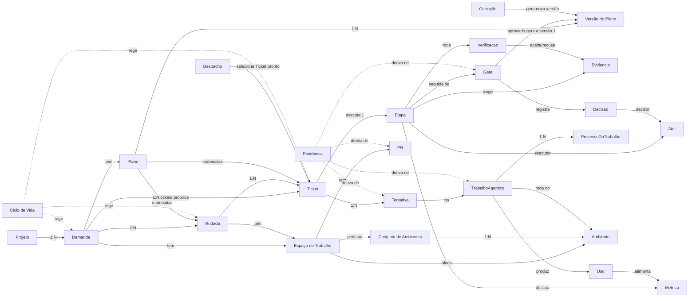

# Mapa dos Conceitos da Fabriquinha

Relações entre os conceitos de `CONCEITOS.md`.

## Como ler

- **Estrutura**: Projeto → Demanda → Rodada → Ticket; o Plano materializa Rodadas e Tickets.
- **Plano**: tem versões; a aprovação do planejamento gera a versão 1, e cada Correção (revisão, Ajustar Resultado ou conferência do PR) gera uma nova.
- **Trabalho**: o Ticket executa uma Etapa, que define Executor (Ator), Evidências exigidas, Verificações, Métricas e o Gate seguinte.
- **Execução**: o Ticket faz Tentativas num Trabalho Agêntico, que roda em Processos no Ambiente do Espaço de Trabalho.
- **Ambiente**: o Espaço de Trabalho pede um Ambiente ao Conjunto de Ambientes, que o aloca, limpa e reutiliza ou elimina.
- **Verificação**: a Etapa roda Verificações no Ambiente (testes, e2e, fitness, Sonar, hooks do commit e conferência do PR); o resultado é aceito ou recusado como Evidência.
- **Tracejado**: conceitos que só regem ou derivam; o Ciclo de Vida rege os Itens de Trabalho, e a Pendência é calculada, nunca gravada.

O Trabalho Não Gerenciado aparece só como Ator Externo e fonte de Uso: não roda no Ambiente nem tem Processo.
