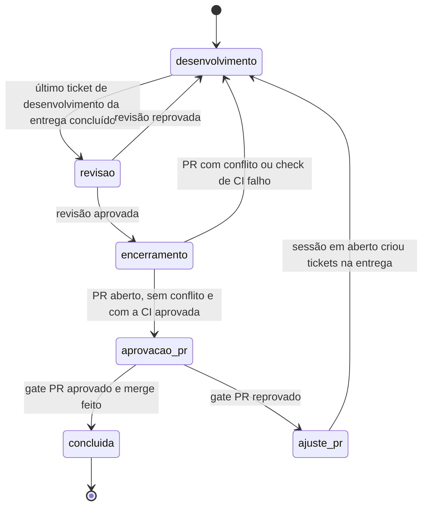
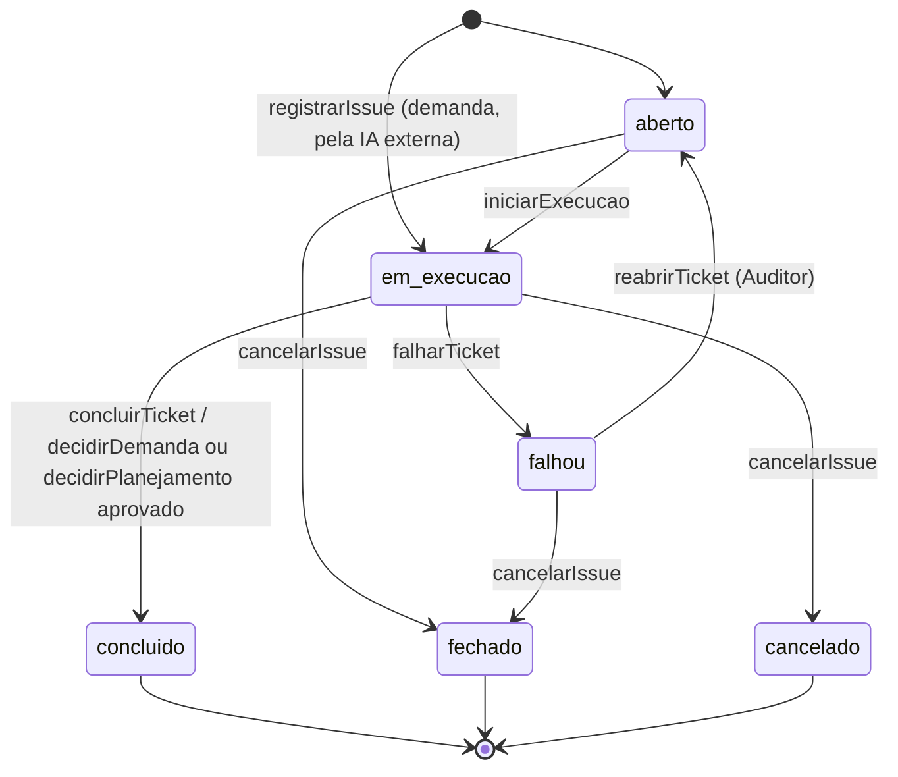

# F1 — Domínio

Sistema: Fabriquinha.
Depende de: nada (sem I/O).
Usado por: F2 a F7.

## 1. Responsabilidade

O domínio codifica o SDLC do diagrama: entidades, fases da issue, status do ticket, gates e quem pode fazer o quê.
Toda mudança de estado da Fabriquinha passa por um comando deste módulo.

O domínio não faz I/O.
Não lê banco, não roda git, não chama o pi e não valida o conteúdo das evidências.
Quem precisa de um fato externo (uma dependência concluída, uma execução em andamento) o recebe por parâmetro.

## 2. Vocabulário

| Termo | Significado |
|---|---|
| Projeto | Repositório git gerenciado pela Fabriquinha, com a sua configuração de testes, SonarQube e fitness functions. |
| Issue | Uma demanda registrada. Atravessa as fases da demanda até o gate final. |
| Demanda | O conteúdo da issue que a IA externa registra: título, tipo, descrição, os artefatos do registro e do desenho e os custos realizados. |
| Entrega | Um conjunto de tickets de desenvolvimento da issue que vira um PR. Tem critérios de aceite atrelados, worktree, branch e fases próprias. |
| Fase | Onde a issue está no SDLC. Só muda por comando do domínio. |
| Ticket | Uma unidade de trabalho de uma etapa. Toda sessão de agente executa exatamente um ticket. |
| Etapa | O tipo do ticket: `demanda`, `planejamento`, `desenvolvimento`, `revisao`, `encerramento`, `sessao`, `revisao_demanda`, `encerramento_demanda` ou `sessao_final`. |
| Execução | Um processo pi rodando um ticket. Um ticket pode ter várias execuções. |
| Evidência | O que comprova o trabalho de um ticket. Os metadados ficam aqui; o conteúdo é validado no F3. |
| Decisão | O veredito de um gate: demanda, planejamento, revisão, PR, revisão da demanda ou final. |
| Ator | Quem pede o comando: Auditor, agente (sempre preso a uma execução) ou a própria Fabriquinha. |

## 3. Data classes

Os schemas são escritos em `zod` (D2) e geram os tipos TypeScript.
Os trechos abaixo mostram campos e validações; não são o código final.
IDs são inteiros gerados pela persistência e exibidos com prefixo: `I-12` (issue), `N-5` (entrega), `T-34` (ticket), `E-7` (execução), `D-3` (decisão).

### 3.1 Primitivos

```ts
const Id = z.number().int().positive();
const Instante = z.iso.datetime({ offset: true });
const Titulo = z.string().trim().min(1).max(120).regex(/^[^\n]*$/, "título ocupa uma linha só");
const Markdown = z.string().refine((t) => palavras(t) <= 1000, "texto excede 1.000 palavras");
const Motivo = z.string().trim().min(1).max(2000);
const Slug = z.string().regex(/^[a-z0-9][a-z0-9-]{0,63}$/);
const Modelo = z.object({
  provedor: z.string().regex(/^[a-z0-9][a-z0-9._-]{0,63}$/),
  modelo: z.string().trim().min(1).max(200),
});

const Etapa = z.enum([
  "demanda", "planejamento",
  "desenvolvimento", "revisao", "encerramento", "sessao",
  "revisao_demanda", "encerramento_demanda", "sessao_final",
]);
const Fase = z.enum([
  "demanda", "aprovacao_demanda", "planejamento", "aprovacao_planejamento",
  "execucao", "revisao_demanda", "encerramento_demanda", "aprovacao_final", "ajuste_final", "concluida",
]);
const FaseEntrega = z.enum([
  "desenvolvimento", "revisao", "encerramento", "aprovacao_pr", "ajuste_pr", "concluida",
]);
const Ferramenta = z.enum(["pi", "claude-code", "codex"]);
const EtapaDeEntrega = ["desenvolvimento", "revisao", "encerramento", "sessao"] as const;
```

### 3.2 Ator

```ts
const Ator = z.discriminatedUnion("tipo", [
  z.object({ tipo: z.literal("auditor") }),
  z.object({ tipo: z.literal("agente"), execucao: Id, ticket: Id }),
  z.object({ tipo: z.literal("fabriquinha") }),
  z.object({ tipo: z.literal("externo"), ferramenta: Ferramenta, sessao: z.string().trim().min(1) }),
]);
```

O agente é sempre identificado pela execução que a Fabriquinha abriu para ele (F4 passa o ID por variável de ambiente).
Um agente só age sobre o próprio ticket e sobre a issue desse ticket, e só enquanto a sua execução está em andamento.
O `externo` é a IA de fora da Fabriquinha que chama o CLI sem execução.
Ela é identificada pela ferramenta e pelo identificador da sessão do harness, que o CLI lê do ambiente (F7, 3.2).
Ela só lê e altera as issues registradas pela mesma ferramenta e sessão (`sessaoExterna`), e só até o envio da demanda (C25).

### 3.3 Projeto

```ts
const Projeto = z.object({
  nome: Slug,
  repo: z.string().refine(isAbsolute, "caminho absoluto"),
  branchBase: z.string().min(1),
  hospedagem: z.enum(["github", "azure-devops"]),
  preparacao: z.array(z.string().trim().min(1)).default([]),
  testes: z.array(z.string().trim().min(1)).min(1),
  sonar: z.object({ projectKey: z.string().min(1) }),
  fitness: z.array(z.object({ nome: Slug, comando: z.string().trim().min(1), descricao: z.string().trim().min(1).max(300) })).min(1)
    .refine(unicoPor("nome"), "nome de fitness function repetido"),
  modelos: z.partialRecord(Etapa, Modelo).default({}),
  efforts: z.partialRecord(Etapa, Effort).optional(),   // Effort = off | minimal | low | medium | high | xhigh | max
});
```

| Campo | Regra |
|---|---|
| `nome` | Único. É a chave do projeto. |
| `repo`, `branchBase`, `hospedagem` | O formato é validado aqui. A existência do repositório, da branch e do remoto é conferida pelo F5 no cadastro. `hospedagem` é deduzida do remoto `origin` e fica gravada. |
| `preparacao` | Comandos que o F5 roda ao criar a worktree (ex.: `npm ci`), para que o agente e os testes encontrem as dependências instaladas. Opcional. Se falhar, a execução falha com o log. |
| `testes` | Pelo menos um comando. Todos precisam sair com código 0 ("aprovação dos testes, todos"). |
| `sonar` | Obrigatório: a evidência do SonarQube é obrigatória na implementação. |
| `fitness` | Pelo menos uma: sem linhas, a matriz não comprova nada. Rodam no gate de desenvolvimento e na revisão. |
| `modelos` | Provedor + modelo por etapa executada pelo pi (todas, menos `demanda` e `encerramento_demanda`). Opcional: etapa sem entrada usa o padrão do pi. A existência do par é conferida no cadastro pelo F4 (`pi --list-models`). |

### 3.4 Issue

```ts
const Issue = z.object({
  id: Id,
  projeto: Slug,
  titulo: Titulo.nullable(),
  tipo: z.enum(["funcionalidade", "problema"]).nullable(),
  descricao: Markdown.default(""),
  fase: Fase,
  sessaoExterna: z.object({ ferramenta: Ferramenta, sessao: z.string().trim().min(1) }).optional(),
  deps: z.array(Id).default([]),
  criadaEm: Instante,
  concluidaEm: Instante.optional(),
  arquivadaEm: Instante.optional(),
  canceladaEm: Instante.optional(),
});
```

| Campo | Regra |
|---|---|
| `titulo`, `tipo` | Obrigatórios desde o registro: a IA externa chega com a demanda escrita. O schema mantém `nullable` só para as issues históricas. |
| `tipo` | `funcionalidade` exige protótipo na demanda; `problema` alimenta a métrica de bugs em arquivos revisados (F6). |
| `titulo`, `tipo`, `descricao` | Ficam congelados depois do envio da demanda. Isso combate o "desvio e ampliação do que deve ser feito". |
| `deps` | Issues de qualquer projeto. Sem ciclo e sem autorreferência. O planejamento só roda quando todas as dependências estão `concluida`. |
| `concluidaEm` | Presente se e somente se `fase = concluida`. |
| `arquivadaEm` | Só em issue `concluida`. Arquivar não apaga nada; a issue some do board e continua acessível por opção explícita. |
| `canceladaEm` | Só em issue que não está `concluida` (C22). A fase fica onde parou; a issue cancelada não muda mais e nada dela é apagado. |
| `sessaoExterna` | A ferramenta e a sessão do harness que registraram a demanda (C1). Ausente só nas issues históricas. Só esse `externo` lê e altera a issue até o envio. |

### 3.4.1 Entrega

```ts
const Entrega = z.object({
  id: Id,                                   // N-n
  issue: Id,
  titulo: Titulo,
  criterios: z.array(z.string().regex(/^CA-\d+$/)).min(1),
  arquivosPrevistos: z.array(z.string().min(1)).default([]),
  deps: z.array(Id).default([]),            // entregas da mesma issue
  fase: FaseEntrega,
  correcao: z.boolean().default(false),
  criadaEm: Instante,
  iniciadaEm: Instante.optional(),
  concluidaEm: Instante.optional(),
});
```

| Campo | Regra |
|---|---|
| `criterios` | Ids da evidência `criterios_aceite` da demanda. Cada critério da demanda está em exatamente uma entrega que não é de correção. A entrega de correção cita os critérios que reabre. |
| `arquivosPrevistos` | Os arquivos previstos no `desenho_solucao` da demanda que cabem a esta entrega, atrelados pelo planejador como os critérios. O `arquivos_alterados` da revisão da entrega compara com eles (F3). |
| `deps` | Entregas da mesma issue, sem ciclo. A entrega só começa quando todas as dependências estão `concluida`, isto é, mergeadas. |
| `fase` | Só muda por comando. Nasce em `desenvolvimento`; enquanto `iniciadaEm` falta, nenhum ticket dela rodou. |
| `correcao` | Criada pela revisão da demanda (C14 da revisão da demanda) ou pela sessão final; nasce liberada, sem gate de planejamento. |
| `iniciadaEm` | Quando a primeira execução dela começou; é quando o F5 cria a worktree e a branch a partir da base atualizada. |
| `concluidaEm` | Presente se e somente se `fase = concluida`: o PR dela foi aprovado e mergeado. |

Antes do gate de planejamento aprovado, a árvore (entregas, tickets, critérios, arquivos previstos e dependências) é livre para o planejador e o Auditor.
Depois dele, a árvore congela: nenhuma entrega é criada, editada ou removida, salvo a entrega de correção.

### 3.5 Ticket

```ts
const Ticket = z.object({
  id: Id,
  issue: Id,
  entrega: Id.optional(),
  etapa: Etapa,
  titulo: Titulo,
  descricao: Markdown.default(""),
  status: z.enum(["aberto", "em_execucao", "concluido", "falhou", "fechado", "cancelado"]),
  origem: z.enum(["fabriquinha", "agente", "auditor", "externo"]),
  origemTicket: Id.optional(),
  deps: z.array(Id).default([]),
  modelo: Modelo.optional(),
  instrucao: Markdown.optional(),
  erro: z.string().max(2000).optional(),
  criadoEm: Instante,
  concluidoEm: Instante.optional(),
  enviadoEm: Instante.optional(),
});
```

| Campo | Regra |
|---|---|
| `etapa` | Só `desenvolvimento` pode ser criado por agente ou Auditor; as demais etapas nascem de transições. |
| `entrega` | Presente se e somente se a etapa é `desenvolvimento`, `revisao`, `encerramento` ou `sessao`. |
| `enviadoEm` | Só em `demanda` e `planejamento`: quando a IA externa ou o planejador enviou o resultado à aprovação (C25). No planejamento, sai quando o Auditor reprova (C15). |
| `deps` | Só em `desenvolvimento`: tickets da mesma entrega, sem ciclo. O ticket só começa quando todas estão `concluido`. Ticket removido sai das dependências de quem dependia dele. |
| `origemTicket` | Ticket cuja execução criou este. Obrigatório quando `origem = agente`. Alimenta "exigências de alteração" (origem numa revisão) no F6. |
| `modelo` | Override do modelo da etapa só para este ticket. Só o Auditor define, porque modelo é custo por execução. |
| `instrucao` | Resposta do Auditor a uma falha (C9). Abre o prompt da próxima execução e é consumida por C5 (F4, 6.4). |
| `erro` | Presente se e somente se `status = falhou`. |
| `concluidoEm` | Presente se e somente se `status = concluido`. |
| `fechado`, `cancelado` | Só pelo C22: `fechado` é o ticket `aberto` ou `falhou` de uma issue cancelada (sem `erro`); `cancelado` é o que estava `em_execucao`. Não voltam a mudar. |

Dentro da entrega, o próximo ticket de desenvolvimento é o primeiro aberto, em ordem de criação, cujas dependências estão concluídas.

### 3.6 Execução

```ts
const Execucao = z.object({
  id: Id,
  ticket: Id,
  modo: z.enum(["autonomo", "interativo", "consulta"]),
  sessaoPi: z.uuid(),
  modelo: Modelo.optional(),
  resultado: z.enum(["em_andamento", "sucesso", "falha"]),
  erro: z.string().max(2000).optional(),
  iniciadaEm: Instante,
  terminadaEm: Instante.optional(),
});
```

| Regra |
|---|
| `sessao_final` roda em modo `interativo`; as demais etapas executadas pelo pi, em `autonomo`, inclusive quando o Auditor dispara à mão. `demanda` não tem execução: a IA externa trabalha fora. `encerramento_demanda` não tem execução: é a Fabriquinha que produz as evidências. |
| `consulta` é uma conversa do Auditor sobre a sessão de qualquer ticket, sem as ferramentas embutidas de escrita (`edit`, `write`, `bash`); não muda o estado do ticket (C21). |
| `terminadaEm` está presente se e somente se `resultado ≠ em_andamento`; `erro`, se e somente se `resultado = falha`. |
| `modelo` é o par pedido ao pi nesta execução (3.10); ausente quando valeu o padrão do pi. O consumo real por modelo vem da sessão (F6). |
| As execuções autônomas e interativas de um ticket compartilham a sessão principal (mesmo `sessaoPi`). Cada consulta tem uma sessão própria, copiada da principal (F4, 6.5). |

### 3.7 Decisão

```ts
const Decisao = z.object({
  id: Id,
  issue: Id,
  entrega: Id.optional(),
  ticket: Id,
  gate: z.enum(["demanda", "planejamento", "revisao", "pr", "revisao_demanda", "final"]),
  aprovado: z.boolean(),
  motivo: Motivo.optional(),
  nota: z.number().int().min(1).max(5).optional(),
  por: z.enum(["auditor", "agente"]),
  em: Instante,
});
```

| Regra |
|---|
| `por = agente` se e somente se `gate ∈ {revisao, revisao_demanda}`. |
| `motivo` é obrigatório quando `aprovado = false`. |
| `nota` é obrigatória se e somente se `gate ∈ {pr, final}`, aprovado ou não: é o "feedback humano da qualidade", do PR e da demanda. |
| `entrega` está presente se e somente se `gate ∈ {revisao, pr}`. |
| `ticket` aponta o ticket cujo resultado foi julgado: o de demanda, o de planejamento, o de revisão, o de encerramento da entrega, o de revisão da demanda ou o de encerramento da demanda. |
| Uma decisão de revisão por ticket; registrar outra durante a mesma execução substitui a anterior. |

### 3.8 Evidência (metadados)

```ts
const Evidencia = z.object({
  ticket: Id,
  tipo: TipoEvidencia,
  produtor: z.enum(["agente", "externo", "fabriquinha"]),
  aprovada: z.boolean().optional(),
  em: Instante,
});
```

O conteúdo (`dados` e arquivos) e o schema de cada tipo ficam no F3.
`aprovada` existe nos tipos em que o conteúdo tem um resultado binário (testes, SonarQube, matriz de fitness, comprovação de critérios) e é sempre calculada pelo F3; ninguém a declara.
Há no máximo uma evidência por par (ticket, tipo); submeter de novo substitui.

### 3.9 Catálogo de evidências por etapa

O catálogo é regra de negócio e mora aqui; o F3 implementa os schemas e os coletores.

| Etapa | Tipo | Produtor | Obrigatória |
|---|---|---|---|
| demanda | `comportamento` (vídeo e/ou código) | externo | sim |
| demanda | `criterios_aceite` | externo | sim |
| demanda | `desenho_solucao` | externo | sim |
| demanda | `prototipo` (protótipo + vídeo/print) | externo | se `tipo = funcionalidade` |
| demanda | `relatorio_complexidade` | externo | sim |
| demanda | `relatorio_impactos_arquitetura` | externo | sim |
| demanda | `custos_realizados` | externo | sim |
| planejamento | `arvore_planejamento` | fabriquinha | sim, gerada no envio |
| desenvolvimento | `execucao_testes` | fabriquinha | sim, com `aprovada = true` |
| desenvolvimento | `matriz_fitness` | fabriquinha | sim, com `aprovada = true` |
| desenvolvimento | `relatorio_sonar` | fabriquinha | sim, com `aprovada = true` (D6) |
| revisao | `arquivos_alterados` | fabriquinha | sim |
| revisao | `matriz_fitness` | fabriquinha | sim |
| revisao | `explicacao_fitness` | agente | sim, uma explicação por linha da matriz |
| revisao | `comprovacao_criterios` | agente | sim, dos critérios da entrega |
| encerramento | `mensagem_pr` | agente | sim |
| encerramento | `aula_codigo` | agente | sim |
| encerramento | `video_demonstracao` | agente | não: só quando a mudança aparece no cliente, e quem decide é o agente |
| encerramento | `relatorio_produtividade` | fabriquinha | sim, da entrega |
| encerramento | `pr_aberto` | fabriquinha | sim |
| revisao_demanda | `comprovacao_criterios` | agente | sim, de todos os critérios da demanda |
| encerramento_demanda | `arvore_prs_criterios_custos` | fabriquinha | sim |
| encerramento_demanda | `demonstracao_limpeza` | fabriquinha | sim |
| sessao, sessao_final | — | — | — |

O agente e a IA externa não podem submeter tipo cujo produtor é a Fabriquinha (princípio 2 da visão geral).

### 3.10 Escolha do modelo

O F4 resolve o modelo de cada execução nesta ordem e passa o par ao pi (`--provider`, `--model`):

1. `ticket.modelo`;
2. `projeto.modelos[ticket.etapa]`;
3. o padrão configurado no pi.

## 4. Máquina de estados

### 4.1 Fases da issue

```mermaid
stateDiagram-v2
    [*] --> demanda
    demanda --> aprovacao_demanda: demanda enviada (C25)
    aprovacao_demanda --> planejamento: gate demanda aprovado
    planejamento --> aprovacao_planejamento: planejamento enviado (C25)
    aprovacao_planejamento --> execucao: gate planejamento aprovado
    aprovacao_planejamento --> planejamento: gate planejamento reprovado
    execucao --> revisao_demanda: última entrega concluída
    revisao_demanda --> encerramento_demanda: revisão da demanda aprovada
    revisao_demanda --> execucao: revisão da demanda reprovada (entrega de correção)
    encerramento_demanda --> aprovacao_final: artefatos do encerramento gerados
    aprovacao_final --> concluida: gate final aprovado
    aprovacao_final --> ajuste_final: gate final reprovado
    ajuste_final --> execucao: sessão final criou entrega de correção
    concluida --> [*]
    note right of demanda: qualquer fase, menos concluida, pode ser cancelada (C22); o gate demanda recusado cancela
```



### 4.1.1 Fases da entrega

A entrega percorre o ciclo que a issue percorria até o PR.
Ela só começa quando a issue está em `execucao` e todas as entregas de que depende estão `concluida`.



### 4.2 Status do ticket



O ticket de demanda nasce `em_execucao`, sem execução: a IA externa trabalha nele até o envio, e ele fica assim até o gate da demanda.
Ticket interativo (`sessao_final`) nunca falha: quando o pi sai sem concluir, o ticket continua `em_execucao` e o Auditor retoma a sessão depois.
O planejamento continua `em_execucao` depois do envio (C25), até o Auditor decidir o gate.

### 4.3 Etapa × fase

Um ticket só inicia execução quando a fase da issue corresponde à sua etapa.

| Etapa | Fase exigida |
|---|---|
| demanda | issue em `demanda` |
| planejamento | issue em `planejamento` |
| desenvolvimento | issue em `execucao` e entrega em `desenvolvimento` |
| revisao | issue em `execucao` e entrega em `revisao` |
| encerramento | issue em `execucao` e entrega em `encerramento` |
| sessao | issue em `execucao` e entrega em `ajuste_pr` |
| revisao_demanda | issue em `revisao_demanda` |
| encerramento_demanda | issue em `encerramento_demanda` |
| sessao_final | issue em `ajuste_final` |

## 5. Comandos

Cada comando é uma função pura `(agregado, entrada, ator, contexto) → agregado` que lança erro quando alguma regra é violada.
O agregado é a issue com os seus tickets, execuções, decisões e metadados de evidência.
O contexto traz o instante atual, o gerador de IDs e os fatos externos que o comando precisa.
F2 carrega o agregado, aplica o comando e grava tudo numa transação só.

| # | Comando | Ator | Pré-condições | Efeito |
|---|---|---|---|---|
| C1 | `registrarIssue(projeto, deps, titulo, tipo, descricao)` | IA externa | ferramenta e sessão do harness identificadas (3.2); projeto existe; deps existem e não formam ciclo; descrição até 1.000 palavras | Issue em `demanda`, com título, tipo, descrição e `sessaoExterna`; Ticket `demanda` `em_execucao`, com `origem = externo`. |
| C2 | `editarIssue(issue, {titulo, tipo, descricao})` | IA externa que registrou a issue | fase `demanda`; demanda não enviada | Atualiza os campos. |
| C3 | `adicionarDependencia(issue, dep)` | IA externa que registrou a issue até o envio; Auditor | fase ∈ {`demanda`, `aprovacao_demanda`, `planejamento`, `aprovacao_planejamento`}; dep existe; sem ciclo; não é a própria issue | Adiciona; idempotente. |
| C4 | `removerDependencia(issue, dep)` | IA externa que registrou a issue até o envio; Auditor | idem C3 | Remove; idempotente. |
| C5 | `iniciarExecucao(ticket, modo, sessaoPi)` | Fabriquinha | fase × etapa (4.3); modo × etapa (3.6); nenhum ticket da mesma entrega com execução em andamento, ou, fora de entrega, nenhum da issue; autônomo: ticket `aberto`, deps do ticket concluídas, deps da entrega concluídas; planejamento: deps da issue concluídas; interativo: ticket `aberto` ou `em_execucao` | Ticket `em_execucao`; nova Execução `em_andamento`; consome `ticket.instrucao`; na primeira execução da entrega, grava `iniciadaEm`. |
| C6 | `terminarExecucao(execucao, resultado, erro)` | Fabriquinha | execução `em_andamento` | Grava resultado e término. O ticket não muda. |
| C7 | `concluirTicket(ticket)` | Fabriquinha | ticket `em_execucao`; sem execução em andamento; evidências obrigatórias (3.9); regras da etapa (tabela abaixo) | Ticket `concluido` e a transição da etapa. |
| C8 | `falharTicket(ticket, erro)` | Fabriquinha | ticket autônomo `em_execucao`; sem execução em andamento | Ticket `falhou`; remove os tickets de desenvolvimento e as entregas ainda não iniciadas que ele criou, e a decisão de revisão dele. |
| C9 | `reabrirTicket(ticket, instrucao)` | Auditor | ticket `falhou` | Ticket `aberto`; apaga `erro`; grava `instrucao` quando informada. |
| C10 | `decidirDemanda(issue, aprovado, motivo)` | Auditor | fase `aprovacao_demanda`; ticket de demanda enviado (C25) | Grava a Decisão. Aprovado: ticket de demanda `concluido`, fase `planejamento`, novo Ticket `planejamento`. Recusado: aplica o C22 com o motivo; a demanda não volta à IA. |
| C11 | `adicionarTicketDesenvolvimento(entrega, titulo, descricao, deps, modelo)` | agente de `planejamento` da issue antes do envio; agente de `revisao` ou `sessao` da mesma entrega; agente de `revisao_demanda` ou `sessao_final` numa entrega de correção que ele criou; Auditor na fase `aprovacao_planejamento` | `modelo` só quando o ator é o Auditor; deps na mesma entrega e sem ciclo; fora do planejamento, a entrega não está `concluida` | Ticket `desenvolvimento` aberto, com `origem` e `origemTicket`. |
| C12 | `editarTicket(ticket, {titulo, descricao, deps})` | quem pode criá-lo (C11) | ticket `desenvolvimento` `aberto`; o agente só edita os que a sua execução criou | Atualiza. |
| C13 | `removerTicket(ticket)` | idem C12 | idem C12 | Remove e o tira das dependências de quem dependia dele. |
| C14 | `registrarDecisaoRevisao(ticket, aprovado, motivo)` | agente da revisão da entrega ou da revisão da demanda | ticket `revisao` ou `revisao_demanda` `em_execucao` | Grava ou substitui a Decisão de revisão. |
| C15 | `decidirPlanejamento(issue, aprovado, motivo)` | Auditor | fase `aprovacao_planejamento`; ticket de planejamento enviado (C25) e sem execução em andamento; aprovado: todo critério da demanda numa entrega e toda entrega com pelo menos um ticket | Grava a Decisão. Aprovado: ticket de planejamento `concluido`, fase `execucao`, a árvore congela. Reprovado: fase `planejamento`, o ticket perde o `enviadoEm` e a árvore proposta fica; F4 retoma a mesma sessão com o motivo. |
| C16 | `decidirPR(entrega, aprovado, nota, motivo)` | Auditor | entrega em `aprovacao_pr`; aprovado: o merge já foi feito (F5 chama depois do merge) | Grava a Decisão. Aprovado: entrega `concluida`, `concluidaEm`; se era a última não concluída, fase `revisao_demanda` e novo Ticket `revisao_demanda`. Reprovado: entrega em `ajuste_pr`, novo Ticket `sessao` da entrega com o motivo na descrição. |
| C17 | `registrarEvidencia(ticket, tipo, aprovada)` | agente do ticket ou a IA externa que registrou a issue, para o tipo do seu produtor; Fabriquinha, para os demais | ticket `em_execucao` e não enviado; o tipo pertence à etapa do ticket (3.9) | Grava ou substitui os metadados. O conteúdo já foi validado pelo F3. |
| C18 | `arquivarConcluidas(projeto)` | Auditor | — | `arquivadaEm` em toda issue `concluida` do projeto ainda não arquivada. |
| C19 | `registrarProjeto(projeto)` / `editarProjeto(projeto)` | Auditor | schema 3.3; F5 já conferiu repo, branch e remoto; F4 já conferiu os modelos | Grava. |
| C21 | `iniciarConsulta(ticket, sessaoPi)` | Auditor | o ticket já tem sessão principal; nenhuma execução do ticket em andamento (índice do F2); `sessaoPi` é a nova sessão copiada dela | Nova Execução em modo `consulta`. O ticket não muda. |
| C20 | `definirModeloTicket(ticket, modelo \| null)` | Auditor | ticket não concluído e sem execução em andamento | Define ou remove o override; vale a partir da próxima execução. |
| C22 | `cancelarIssue(issue, motivo?)` | Auditor; Fabriquinha pelo C10 recusado | fase ≠ `concluida`; ainda não cancelada | `canceladaEm`; tickets `aberto` e `falhou` viram `fechado` (sem `erro`), os `em_execucao` viram `cancelado`; toda execução `em_andamento` da issue termina em `falha` com o erro `issue cancelada pelo Auditor`. Não existe cancelar uma entrega sozinha. A F2 aplica o mesmo comando a toda issue que dependa dela, direta ou indiretamente e de qualquer projeto, numa transação só; as issues de que ela depende não mudam. |
| C25 | `enviarParaAprovacao(ticket)` | IA externa que registrou a issue, no ticket de `demanda`; agente do próprio ticket de `planejamento`, com a execução em andamento | ainda não enviado; demanda: evidências de 3.9; planejamento: todo critério numa entrega e toda entrega com pelo menos um ticket | `enviadoEm`; a demanda vai à fase `aprovacao_demanda`; o planejamento gera a `arvore_planejamento` e vai à fase `aprovacao_planejamento`. |
| C26 | `adicionarEntrega(issue, titulo, criterios, arquivosPrevistos, deps)` | agente de `planejamento` antes do envio; Auditor em `aprovacao_planejamento`; agente de `revisao_demanda` ou `sessao_final` (entrega de correção) | critérios existem na demanda; arquivos previstos constam do `desenho_solucao`; deps da mesma issue e sem ciclo; fora do planejamento, só como correção | Entrega em `desenvolvimento`; `correcao = true` quando criada fora do planejamento. |
| C27 | `editarEntrega(entrega, {titulo, criterios, arquivosPrevistos, deps})` | quem pode criá-la (C26) | entrega sem `iniciadaEm`; antes do gate de planejamento aprovado, ou entrega de correção criada pelo mesmo ticket | Atualiza. |
| C28 | `removerEntrega(entrega)` | idem C27 | idem C27 | Remove a entrega, os tickets dela e a tira das dependências de quem dependia dela. |
| C29 | `decidirFinal(issue, aprovado, nota, motivo)` | Auditor | fase `aprovacao_final` | Grava a Decisão. Aprovado: fase `concluida`, `concluidaEm`. Reprovado: fase `ajuste_final`, novo Ticket `sessao_final` com o motivo na descrição. |

Depois do C22 a F2 recusa qualquer outro comando sobre a issue (`a I-n está cancelada e não muda mais`).
Tokens, custo, tickets, execuções, decisões e evidências continuam consultáveis e contando nas métricas.

### 5.1 Regras de C7 por etapa

| Etapa | Regra adicional | Transição |
|---|---|---|
| desenvolvimento | tem commit registrado (F5) | se não sobrar ticket de desenvolvimento não concluído na entrega: entrega em `revisao` e novo Ticket `revisao` da entrega; senão, a entrega continua |
| revisao | tem Decisão de revisão; aprovada ⇒ não criou tickets, `comprovacao_criterios.aprovada` e `matriz_fitness.aprovada` (F3, seção 8); reprovada ⇒ criou pelo menos um | aprovada: entrega em `encerramento` e novo Ticket `encerramento` da entrega; reprovada: entrega em `desenvolvimento` |
| encerramento | `ctx.problemasPR` presente (a coleta verificou o PR, F5 §5.1) | sem conflito e sem check falho: entrega em `aprovacao_pr`; com conflito ou check falho: entrega em `desenvolvimento` e novo Ticket `desenvolvimento` (origem `fabriquinha`) que resolve o conflito com a base ou corrige os checks |
| sessao | criou pelo menos um ticket de desenvolvimento na entrega | entrega em `desenvolvimento` |
| revisao_demanda | tem Decisão de revisão; aprovada ⇒ não criou entrega e `comprovacao_criterios.aprovada`; reprovada ⇒ criou pelo menos uma entrega de correção com ticket | aprovada: fase `encerramento_demanda` e novo Ticket `encerramento_demanda`; reprovada: fase `execucao` |
| encerramento_demanda | `arvore_prs_criterios_custos` e `demonstracao_limpeza` presentes | fase `aprovacao_final` |
| sessao_final | criou pelo menos uma entrega de correção com ticket | fase `execucao` |
| demanda | não usa C7; conclui por C10 | — |
| planejamento | não usa C7; conclui por C15 | — |

## 6. Invariantes

Valem depois de qualquer comando; F2 reforça as que cabem em constraint de banco.

1. No máximo um ticket `em_execucao` por entrega; fora de entrega, no máximo um por issue, e nunca junto com um de entrega.
2. Etapas diferentes de `desenvolvimento` têm no máximo um ticket não concluído por entrega (as de entrega) ou por issue (as demais).
3. No máximo uma execução `em_andamento` por entrega; fora de entrega, no máximo uma por issue.
4. Dependências entre issues, entre entregas e entre tickets não formam ciclo; entre entregas, só na mesma issue; entre tickets, só na mesma entrega.
5. Toda issue tem título e tipo, salvo as históricas anteriores à D12.
6. `arquivadaEm` implica `fase = concluida`.
7. Toda decisão de gate humano tem `por = auditor`; a de revisão e a de revisão da demanda têm `por = agente`.
8. `canceladaEm` implica `fase ≠ concluida`; issue cancelada não tem ticket `aberto`, `falhou` ou `em_execucao`, nem execução `em_andamento`.
9. Fora das fases `demanda`, `aprovacao_demanda` e `planejamento`, todo critério da demanda está em exatamente uma entrega que não é de correção.
10. A issue em `revisao_demanda` ou adiante tem todas as entregas `concluida`.

## 7. Erros

| Classe | Quando | Uso no F7 |
|---|---|---|
| `ErroDeRegra` | pré-condição, schema ou invariante violada | CLI: exit 1; web: HTTP 409 (estado) ou 422 (schema) |
| `ErroDeEscopo` | o ator não pode pedir o comando (agente fora do próprio ticket, agente pedindo comando de Auditor) | CLI: exit 1; web: HTTP 403 |

A mensagem diz o que faltou e como resolver, em uma frase.
Exemplo: `T-34 não pode concluir: falta a evidência relatorio_complexidade (submeta com fabriquinha evidencia add relatorio_complexidade)`.
O agente lê esse texto e corrige sem precisar adivinhar (Feedback.txt, item 1).

## 8. Limites conhecidos

- O agente roda com o mesmo usuário do sistema operacional que a Fabriquinha.
  O CLI não tem comando de Auditor (D9), mas um agente determinado poderia ler o `web.url` com o token ou escrever direto no banco.
  Isolamento de verdade exige rodar o pi com outro usuário ou em contêiner; fica fora desta versão.
- Não há exclusão de issue (Q2). Uma issue registrada por engano se cancela (C22), mas continua no histórico.
- A identidade da IA externa é a ferramenta e o identificador da sessão do harness que o CLI lê do ambiente (3.2), sem segredo.
  Ela basta para uma IA não alterar por engano a demanda de outra sessão, mas não impede quem forjar as variáveis de ambiente; o mesmo vale para o agente.
