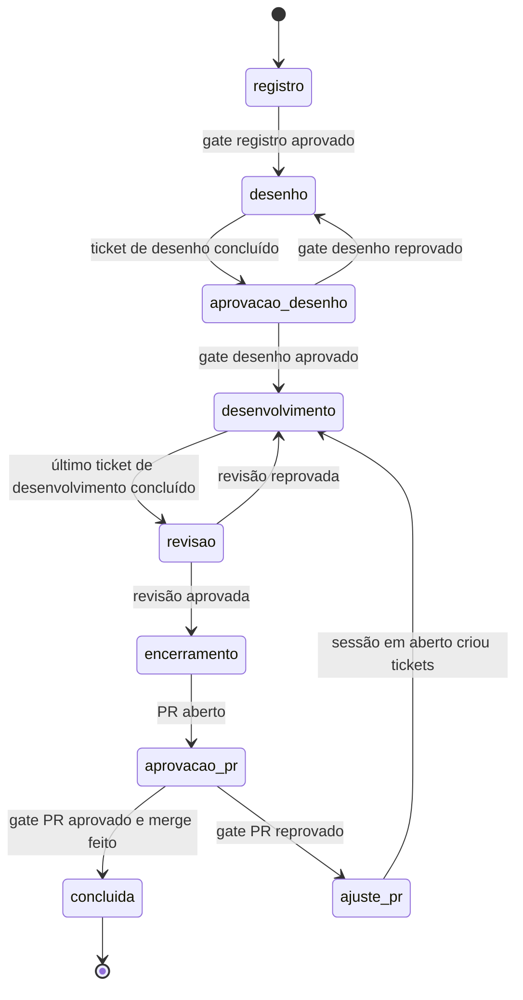
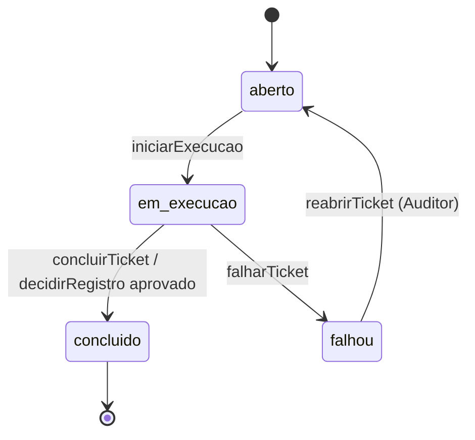

# F1 — Domínio

Sistema: Fabriquinha.
Depende de: nada (sem I/O).
Usado por: F2 a F7.

## 1. Responsabilidade

O domínio codifica o SDLC do diagrama: entidades, fases da issue, status do ticket, gates e quem pode fazer o quê.
Toda mudança de estado da Fabriquinha passa por um comando deste módulo.

O domínio não faz I/O.
Não lê banco, não roda git, não chama o pi e não valida o conteúdo das evidências.
Quem precisa de um fato externo (uma dependência concluída, uma execução em andamento) o recebe por parâmetro.

## 2. Vocabulário

| Termo | Significado |
|---|---|
| Projeto | Repositório git gerenciado pela Fabriquinha, com a sua configuração de testes, SonarQube e fitness functions. |
| Issue | Uma necessidade registrada. Atravessa as fases do SDLC até o PR aprovado. |
| Fase | Onde a issue está no SDLC. Só muda por comando do domínio. |
| Ticket | Uma unidade de trabalho de uma etapa. Toda sessão de agente executa exatamente um ticket. |
| Etapa | O tipo do ticket: `registro`, `desenho`, `desenvolvimento`, `revisao`, `encerramento` ou `sessao`. |
| Execução | Um processo pi rodando um ticket. Um ticket pode ter várias execuções. |
| Evidência | O que comprova o trabalho de um ticket. Os metadados ficam aqui; o conteúdo é validado no F3. |
| Decisão | O veredito de um gate: registro, desenho, revisão ou PR. |
| Ator | Quem pede o comando: Auditor, agente (sempre preso a uma execução) ou a própria Fabriquinha. |

## 3. Data classes

Os schemas são escritos em `zod` (D2) e geram os tipos TypeScript.
Os trechos abaixo mostram campos e validações; não são o código final.
IDs são inteiros gerados pela persistência e exibidos com prefixo: `I-12` (issue), `T-34` (ticket), `E-7` (execução), `D-3` (decisão).

### 3.1 Primitivos

```ts
const Id = z.number().int().positive();
const Instante = z.iso.datetime({ offset: true });
const Titulo = z.string().trim().min(1).max(120).regex(/^[^\n]*$/, "título ocupa uma linha só");
const Markdown = z.string().refine((t) => palavras(t) <= 1000, "texto excede 1.000 palavras");
const Motivo = z.string().trim().min(1).max(2000);
const Slug = z.string().regex(/^[a-z0-9][a-z0-9-]{0,63}$/);
const Modelo = z.object({
  provedor: z.string().regex(/^[a-z0-9][a-z0-9._-]{0,63}$/),
  modelo: z.string().trim().min(1).max(200),
});

const Etapa = z.enum(["registro", "desenho", "desenvolvimento", "revisao", "encerramento", "sessao"]);
const Fase = z.enum([
  "registro", "desenho", "aprovacao_desenho", "desenvolvimento",
  "revisao", "encerramento", "aprovacao_pr", "ajuste_pr", "concluida",
]);
```

### 3.2 Ator

```ts
const Ator = z.discriminatedUnion("tipo", [
  z.object({ tipo: z.literal("auditor") }),
  z.object({ tipo: z.literal("agente"), execucao: Id, ticket: Id }),
  z.object({ tipo: z.literal("fabriquinha") }),
]);
```

O agente é sempre identificado pela execução que a Fabriquinha abriu para ele (F4 passa o ID por variável de ambiente).
Um agente só age sobre o próprio ticket e sobre a issue desse ticket, e só enquanto a sua execução está em andamento.

### 3.3 Projeto

```ts
const Projeto = z.object({
  nome: Slug,
  repo: z.string().refine(isAbsolute, "caminho absoluto"),
  branchBase: z.string().min(1),
  hospedagem: z.enum(["github", "azure-devops"]),
  preparacao: z.array(z.string().trim().min(1)).default([]),
  testes: z.array(z.string().trim().min(1)).min(1),
  sonar: z.object({ projectKey: z.string().min(1) }),
  fitness: z.array(z.object({ nome: Slug, comando: z.string().trim().min(1), descricao: z.string().trim().min(1).max(300) })).min(1)
    .refine(unicoPor("nome"), "nome de fitness function repetido"),
  modelos: z.partialRecord(Etapa, Modelo).default({}),
});
```

| Campo | Regra |
|---|---|
| `nome` | Único. É a chave do projeto. |
| `repo`, `branchBase`, `hospedagem` | O formato é validado aqui. A existência do repositório, da branch e do remoto é conferida pelo F5 no cadastro. `hospedagem` é deduzida do remoto `origin` e fica gravada. |
| `preparacao` | Comandos que o F5 roda ao criar a worktree (ex.: `npm ci`), para que o agente e os testes encontrem as dependências instaladas. Opcional. Se falhar, a execução falha com o log. |
| `testes` | Pelo menos um comando. Todos precisam sair com código 0 ("aprovação dos testes, todos"). |
| `sonar` | Obrigatório: a evidência do SonarQube é obrigatória na implementação. |
| `fitness` | Pelo menos uma: sem linhas, a matriz não comprova nada. Rodam no gate de desenvolvimento e na revisão. |
| `modelos` | Provedor + modelo por etapa. Opcional: etapa sem entrada usa o padrão do pi. A existência do par é conferida no cadastro pelo F4 (`pi --list-models`). |

### 3.4 Issue

```ts
const Issue = z.object({
  id: Id,
  projeto: Slug,
  titulo: Titulo.nullable(),
  tipo: z.enum(["funcionalidade", "problema"]).nullable(),
  descricao: Markdown.default(""),
  fase: Fase,
  deps: z.array(Id).default([]),
  criadaEm: Instante,
  concluidaEm: Instante.optional(),
  arquivadaEm: Instante.optional(),
});
```

| Campo | Regra |
|---|---|
| `titulo`, `tipo` | Podem faltar só na fase `registro`; o gate de registro exige os dois. |
| `tipo` | `funcionalidade` exige protótipo no desenho; `problema` alimenta a métrica de bugs em arquivos revisados (F6). |
| `titulo`, `tipo`, `descricao` | Ficam congelados depois do registro. Isso combate o "desvio e ampliação do que deve ser feito". |
| `deps` | Issues de qualquer projeto. Sem ciclo e sem autorreferência. Nenhum ticket autônomo da issue roda enquanto alguma dependência não estiver `concluida`. |
| `concluidaEm` | Presente se e somente se `fase = concluida`. |
| `arquivadaEm` | Só em issue `concluida`. Arquivar não apaga nada; a issue some do board e continua acessível por opção explícita. |

### 3.5 Ticket

```ts
const Ticket = z.object({
  id: Id,
  issue: Id,
  etapa: Etapa,
  titulo: Titulo,
  descricao: Markdown.default(""),
  status: z.enum(["aberto", "em_execucao", "concluido", "falhou"]),
  origem: z.enum(["fabriquinha", "agente", "auditor"]),
  origemTicket: Id.optional(),
  modelo: Modelo.optional(),
  instrucao: Markdown.optional(),
  erro: z.string().max(2000).optional(),
  criadoEm: Instante,
  concluidoEm: Instante.optional(),
});
```

| Campo | Regra |
|---|---|
| `etapa` | Só `desenvolvimento` pode ser criado por agente ou Auditor; as demais etapas nascem de transições. |
| `origemTicket` | Ticket cuja execução criou este. Obrigatório quando `origem = agente`. Alimenta "exigências de alteração" (origem numa revisão) no F6. |
| `modelo` | Override do modelo da etapa só para este ticket. Só o Auditor define, porque modelo é custo por execução. |
| `instrucao` | Resposta do Auditor a uma falha (C9). Abre o prompt da próxima execução e é consumida por C5 (F4, 6.4). |
| `erro` | Presente se e somente se `status = falhou`. |
| `concluidoEm` | Presente se e somente se `status = concluido`. |

A ordem de execução dos tickets de desenvolvimento é a ordem de criação; não há dependência entre tickets.

### 3.6 Execução

```ts
const Execucao = z.object({
  id: Id,
  ticket: Id,
  modo: z.enum(["autonomo", "interativo", "consulta"]),
  sessaoPi: z.uuid(),
  modelo: Modelo.optional(),
  resultado: z.enum(["em_andamento", "sucesso", "falha"]),
  erro: z.string().max(2000).optional(),
  iniciadaEm: Instante,
  terminadaEm: Instante.optional(),
});
```

| Regra |
|---|
| `registro` e `sessao` rodam em modo `interativo`; as demais etapas, em `autonomo`, inclusive quando o Auditor dispara à mão. |
| `consulta` é uma conversa do Auditor sobre a sessão de qualquer ticket, sem as ferramentas embutidas de escrita (`edit`, `write`, `bash`); não muda o estado do ticket (C21). |
| `terminadaEm` está presente se e somente se `resultado ≠ em_andamento`; `erro`, se e somente se `resultado = falha`. |
| `modelo` é o par pedido ao pi nesta execução (3.10); ausente quando valeu o padrão do pi. O consumo real por modelo vem da sessão (F6). |
| As execuções autônomas e interativas de um ticket compartilham a sessão principal (mesmo `sessaoPi`). Cada consulta tem uma sessão própria, copiada da principal (F4, 6.5). |

### 3.7 Decisão

```ts
const Decisao = z.object({
  id: Id,
  issue: Id,
  ticket: Id,
  gate: z.enum(["registro", "desenho", "revisao", "pr"]),
  aprovado: z.boolean(),
  motivo: Motivo.optional(),
  nota: z.number().int().min(1).max(5).optional(),
  por: z.enum(["auditor", "agente"]),
  em: Instante,
});
```

| Regra |
|---|
| `por = agente` se e somente se `gate = revisao`. |
| `motivo` é obrigatório quando `aprovado = false`. |
| `nota` é obrigatória se e somente se `gate = pr`, aprovado ou não: é o "feedback humano da qualidade". |
| `ticket` aponta o ticket cujo resultado foi julgado: o de registro, o de desenho, o de revisão ou o de encerramento. |
| Uma decisão de revisão por ticket; registrar outra durante a mesma execução substitui a anterior. |

### 3.8 Evidência (metadados)

```ts
const Evidencia = z.object({
  ticket: Id,
  tipo: TipoEvidencia,
  produtor: z.enum(["agente", "fabriquinha"]),
  aprovada: z.boolean().optional(),
  em: Instante,
});
```

O conteúdo (`dados` e arquivos) e o schema de cada tipo ficam no F3.
`aprovada` existe nos tipos em que o conteúdo tem um resultado binário (testes, SonarQube, matriz de fitness, comprovação de critérios) e é sempre calculada pelo F3; ninguém a declara.
Há no máximo uma evidência por par (ticket, tipo); submeter de novo substitui.

### 3.9 Catálogo de evidências por etapa

O catálogo é regra de negócio e mora aqui; o F3 implementa os schemas e os coletores.

| Etapa | Tipo | Produtor | Obrigatória |
|---|---|---|---|
| registro | `comportamento` (vídeo e/ou código) | agente | sim |
| registro | `criterios_aceite` | agente | sim |
| desenho | `desenho_solucao` | agente | sim |
| desenho | `prototipo` (protótipo + vídeo/print) | agente | se `tipo = funcionalidade` |
| desenho | `relatorio_complexidade` | agente | sim |
| desenho | `relatorio_impactos_arquitetura` | agente | sim |
| desenvolvimento | `execucao_testes` | fabriquinha | sim, com `aprovada = true` |
| desenvolvimento | `matriz_fitness` | fabriquinha | sim, com `aprovada = true` |
| desenvolvimento | `relatorio_sonar` | fabriquinha | sim, com `aprovada = true` (D6) |
| revisao | `arquivos_alterados` | fabriquinha | sim |
| revisao | `matriz_fitness` | fabriquinha | sim |
| revisao | `explicacao_fitness` | agente | sim, uma explicação por linha da matriz |
| revisao | `comprovacao_criterios` | agente | sim |
| encerramento | `mensagem_pr` | agente | sim |
| encerramento | `video_explicativo` | agente | sim |
| encerramento | `relatorio_produtividade` | fabriquinha | sim |
| encerramento | `pr_aberto` | fabriquinha | sim |
| sessao | — | — | — |

O agente não pode submeter tipo cujo produtor é a Fabriquinha (princípio 2 da visão geral).

### 3.10 Escolha do modelo

O F4 resolve o modelo de cada execução nesta ordem e passa o par ao pi (`--provider`, `--model`):

1. `ticket.modelo`;
2. `projeto.modelos[ticket.etapa]`;
3. o padrão configurado no pi.

## 4. Máquina de estados

### 4.1 Fases da issue



### 4.2 Status do ticket



Ticket interativo (`registro`, `sessao`) nunca falha: quando o pi sai sem concluir, o ticket continua `em_execucao` e o Auditor retoma a sessão depois.

### 4.3 Etapa × fase

Um ticket só inicia execução quando a fase da issue corresponde à sua etapa.

| Etapa | Fase exigida |
|---|---|
| registro | `registro` |
| desenho | `desenho` |
| desenvolvimento | `desenvolvimento` |
| revisao | `revisao` |
| encerramento | `encerramento` |
| sessao | `ajuste_pr` |

## 5. Comandos

Cada comando é uma função pura `(agregado, entrada, ator, contexto) → agregado` que lança erro quando alguma regra é violada.
O agregado é a issue com os seus tickets, execuções, decisões e metadados de evidência.
O contexto traz o instante atual, o gerador de IDs e os fatos externos que o comando precisa.
F2 carrega o agregado, aplica o comando e grava tudo numa transação só.

| # | Comando | Ator | Pré-condições | Efeito |
|---|---|---|---|---|
| C1 | `registrarIssue(projeto, deps)` | Auditor | projeto existe; deps existem e não formam ciclo | Issue em `registro`, sem título e tipo; Ticket `registro` aberto. |
| C2 | `editarIssue(issue, {titulo, tipo, descricao})` | agente do registro ou Auditor | fase `registro` | Atualiza os campos. |
| C3 | `adicionarDependencia(issue, dep)` | agente do registro ou Auditor | fase ≠ `concluida`; dep existe; sem ciclo; não é a própria issue | Adiciona; idempotente. |
| C4 | `removerDependencia(issue, dep)` | agente do registro ou Auditor | fase ≠ `concluida` | Remove; idempotente. |
| C5 | `iniciarExecucao(ticket, modo, sessaoPi)` | Fabriquinha | fase × etapa (4.3); modo × etapa (3.6); nenhum ticket da issue com execução em andamento; autônomo: ticket `aberto`, deps da issue concluídas; interativo: ticket `aberto` ou `em_execucao` | Ticket `em_execucao`; nova Execução `em_andamento`; consome `ticket.instrucao`. |
| C6 | `terminarExecucao(execucao, resultado, erro)` | Fabriquinha | execução `em_andamento` | Grava resultado e término. O ticket não muda. |
| C7 | `concluirTicket(ticket)` | Fabriquinha | ticket `em_execucao`; sem execução em andamento; evidências obrigatórias (3.9); regras da etapa (tabela abaixo) | Ticket `concluido` e a transição da etapa. |
| C8 | `falharTicket(ticket, erro)` | Fabriquinha | ticket autônomo `em_execucao`; sem execução em andamento | Ticket `falhou`; remove os tickets de desenvolvimento ainda abertos que ele criou e a decisão de revisão dele. |
| C9 | `reabrirTicket(ticket, instrucao)` | Auditor | ticket `falhou` | Ticket `aberto`; apaga `erro`; grava `instrucao` quando informada. |
| C10 | `decidirRegistro(issue, aprovado, motivo)` | Auditor | fase `registro`; ticket de registro sem execução em andamento; aprovado: título, tipo e evidências do registro presentes | Grava a Decisão. Aprovado: ticket de registro `concluido`, fase `desenho`, novo Ticket `desenho`. Reprovado: nada mais muda; F4 retoma a sessão com o motivo. |
| C11 | `adicionarTicketDesenvolvimento(issue, titulo, descricao, modelo)` | agente de `desenho`, `revisao` ou `sessao` da mesma issue; Auditor na fase `aprovacao_desenho` | `modelo` só quando o ator é o Auditor | Ticket `desenvolvimento` aberto, com `origem` e `origemTicket`. |
| C12 | `editarTicket(ticket, {titulo, descricao})` | quem pode criá-lo (C11) | ticket `desenvolvimento` `aberto`; o agente só edita os que a sua execução criou | Atualiza. |
| C13 | `removerTicket(ticket)` | idem C12 | idem C12 | Remove. |
| C14 | `registrarDecisaoRevisao(ticket, aprovado, motivo)` | agente da revisão | ticket `revisao` `em_execucao` | Grava ou substitui a Decisão de revisão. |
| C15 | `decidirDesenho(issue, aprovado, motivo)` | Auditor | fase `aprovacao_desenho`; aprovado: há ticket de desenvolvimento aberto | Grava a Decisão. Aprovado: fase `desenvolvimento`. Reprovado: remove os tickets de desenvolvimento abertos, fase `desenho`, novo Ticket `desenho` com o motivo na descrição. |
| C16 | `decidirPR(issue, aprovado, nota, motivo)` | Auditor | fase `aprovacao_pr`; aprovado: o merge já foi feito (F5 chama depois do merge) | Grava a Decisão. Aprovado: fase `concluida`, `concluidaEm`. Reprovado: fase `ajuste_pr`, novo Ticket `sessao` com o motivo na descrição. |
| C17 | `registrarEvidencia(ticket, tipo, aprovada)` | agente do ticket, para tipo de produtor agente; Fabriquinha, para os demais | ticket `em_execucao`; o tipo pertence à etapa do ticket (3.9) | Grava ou substitui os metadados. O conteúdo já foi validado pelo F3. |
| C18 | `arquivarConcluidas(projeto)` | Auditor | — | `arquivadaEm` em toda issue `concluida` do projeto ainda não arquivada. |
| C19 | `registrarProjeto(projeto)` / `editarProjeto(projeto)` | Auditor | schema 3.3; F5 já conferiu repo, branch e remoto; F4 já conferiu os modelos | Grava. |
| C21 | `iniciarConsulta(ticket, sessaoPi)` | Auditor | o ticket já tem sessão principal; nenhuma execução do ticket em andamento (índice do F2); `sessaoPi` é a nova sessão copiada dela | Nova Execução em modo `consulta`. O ticket não muda. |
| C20 | `definirModeloTicket(ticket, modelo \| null)` | Auditor | ticket não concluído e sem execução em andamento | Define ou remove o override; vale a partir da próxima execução. |

### 5.1 Regras de C7 por etapa

| Etapa | Regra adicional | Transição |
|---|---|---|
| desenho | criou pelo menos um ticket de desenvolvimento | fase `aprovacao_desenho` |
| desenvolvimento | tem commit registrado (F5) | se não sobrar ticket de desenvolvimento não concluído na issue: fase `revisao` e novo Ticket `revisao`; senão, a fase continua |
| revisao | tem Decisão de revisão; aprovada ⇒ não criou tickets, `comprovacao_criterios.aprovada` e `matriz_fitness.aprovada` (F3, seção 8); reprovada ⇒ criou pelo menos um | aprovada: fase `encerramento` e novo Ticket `encerramento`; reprovada: fase `desenvolvimento` |
| encerramento | — | fase `aprovacao_pr` |
| sessao | criou pelo menos um ticket de desenvolvimento | fase `desenvolvimento` |
| registro | não usa C7; conclui por C10 | — |

## 6. Invariantes

Valem depois de qualquer comando; F2 reforça as que cabem em constraint de banco.

1. No máximo um ticket `em_execucao` por issue.
2. Etapas diferentes de `desenvolvimento` têm no máximo um ticket não concluído por issue.
3. No máximo uma execução `em_andamento` por issue.
4. Dependências entre issues não formam ciclo.
5. Fora da fase `registro`, a issue tem título e tipo.
6. `arquivadaEm` implica `fase = concluida`.
7. Toda decisão de gate humano tem `por = auditor`; a de revisão tem `por = agente`.

## 7. Erros

| Classe | Quando | Uso no F7 |
|---|---|---|
| `ErroDeRegra` | pré-condição, schema ou invariante violada | CLI: exit 1; web: HTTP 409 (estado) ou 422 (schema) |
| `ErroDeEscopo` | o ator não pode pedir o comando (agente fora do próprio ticket, agente pedindo comando de Auditor) | CLI: exit 1; web: HTTP 403 |

A mensagem diz o que faltou e como resolver, em uma frase.
Exemplo: `T-34 não pode concluir: falta a evidência relatorio_complexidade (submeta com fabriquinha evidencia add relatorio_complexidade)`.
O agente lê esse texto e corrige sem precisar adivinhar (Feedback.txt, item 1).

## 8. Limites conhecidos

- O agente roda com o mesmo usuário do sistema operacional que a Fabriquinha.
  O CLI não tem comando de Auditor (D9), mas um agente determinado poderia ler o `web.url` com o token ou escrever direto no banco.
  Isolamento de verdade exige rodar o pi com outro usuário ou em contêiner; fica fora desta versão.
- Não há cancelamento nem exclusão de issue (Q2).
  Uma issue registrada por engano fica parada na fase em que estiver.
