# F5 — Repositório

Sistema: Fabriquinha.
Depende de: F1 (Projeto, C7 de desenvolvimento, C16), F2 (transações).
Usado por: F3 (diff, descarte, commit, PR), F4 (worktree antes de cada execução), F7 (cadastro de projeto, gate do PR).

## 1. Responsabilidade

- Conferir, no cadastro, que o projeto é um repositório git utilizável e descobrir onde ele é hospedado.
- Dar a cada issue a sua worktree e a sua branch (princípio 7), com as dependências instaladas.
- Fazer o commit de cada ticket de desenvolvimento aprovado no gate e registrar o que ele mudou.
- Descartar o que as outras etapas alteraram.
- Abrir, atualizar e fazer o merge do PR no GitHub ou no Azure DevOps.
- Limpar worktree e branches quando a issue termina ("trabalhos encerrados sem limpeza").

Todo comando externo (`git`, `gh`, `az`) roda com `spawn` e argumentos em lista, sem shell.
Assim, título de ticket e corpo de PR nunca são interpretados como comando.
A única exceção é `projeto.preparacao`, que é comando de shell configurado pelo Auditor (3.2).

## 2. Cadastro do projeto

Antes de C19, o F5 confere, nesta ordem, e para no primeiro problema com uma mensagem que diz o que fazer:

| # | Conferência | Como |
|---|---|---|
| 1 | `repo` é a raiz de um repositório git | `git -C <repo> rev-parse --show-toplevel` devolve o próprio caminho |
| 2 | Há identidade para os commits | `git -C <repo> config user.name` e `user.email` não vazios |
| 3 | Há remoto `origin` e ele é GitHub ou Azure DevOps | URL do `origin` casa com um dos padrões de 2.1 |
| 4 | `branchBase` existe no remoto | `git -C <repo> ls-remote --heads origin <branchBase>` |
| 5 | O CLI da hospedagem está autenticado | GitHub: `gh auth status`. Azure DevOps: `az account show` e a extensão `azure-devops` instalada |

### 2.1 Hospedagem pelo remoto

| Hospedagem | Formatos de URL do `origin` aceitos |
|---|---|
| `github` | `https://github.com/<dono>/<repo>[.git]`, `git@github.com:<dono>/<repo>[.git]` |
| `azure-devops` | `https://dev.azure.com/<org>/<projeto>/_git/<repo>`, `https://<org>.visualstudio.com/<projeto>/_git/<repo>`, `git@ssh.dev.azure.com:v3/<org>/<projeto>/<repo>`, `<org>@vs-ssh.visualstudio.com:v3/<org>/<projeto>/<repo>` |

Qualquer outro host (GitHub Enterprise, GitLab, Bitbucket) é recusado no cadastro.
A hospedagem descoberta é gravada em `projeto.hospedagem` (F1, 3.3).
`gh` e `az repos ... --detect true` descobrem dono, organização e repositório pelo próprio remoto, então não há mais nada a guardar.

## 3. Worktree da issue

| Item | Valor |
|---|---|
| Caminho | `<raiz>/worktrees/<projeto>/I-<n>` |
| Branch | `fabriquinha/I-<n>` |
| Ponto de partida | `origin/<branchBase>`, buscado com `git fetch` na criação |

A worktree fica **fora** do repositório de propósito.
Dentro dele, o test runner e o mutation testing do próprio repositório varreriam as worktrees; foi o que levou ao ajuste do `.worktrees` no Stryker do issues-local.

### 3.1 Ciclo de vida

```mermaid
stateDiagram-v2
    [*] --> criada: registro (F4, 6.6)
    criada --> preparada: projeto.preparacao OK
    criada --> criada: preparação falhou (mostra o log; tenta de novo na próxima execução)
    preparada --> preparada: commits dos tickets de desenvolvimento
    preparada --> removida: PR mergeado (C16 aprovado)
    removida --> [*]
```



`garantirWorktree`, chamado pelo F4 antes de toda execução:

1. Se a worktree existe e está preparada, devolve o caminho.
2. Se não existe e a branch também não existe: `git fetch origin <branchBase>` e `git worktree add -b fabriquinha/I-<n> <caminho> origin/<branchBase>`.
3. Se não existe, mas a branch existe (alguém apagou a pasta): `git worktree prune` e `git worktree add <caminho> fabriquinha/I-<n>`.
4. Roda a preparação (3.2) sempre que a worktree acabou de ser criada ou a última preparação falhou.
5. Se buscou a base no passo 2, chama `varrerBase` (F6, 4.4); falha só vai para o log.

Se a branch `fabriquinha/I-<n>` já existe sem pertencer à issue (sobra de outra instalação), o F5 recusa e pede ao Auditor para removê-la; nunca sobrescreve.

### 3.2 Preparação

- Cada comando de `projeto.preparacao` roda como `/bin/sh -c "<comando>"`, com `cwd` na worktree, em ordem, parando no primeiro que falhar.
- Limite de 30 minutos por comando, como os coletores do F3.
- O log vai para `<raiz>/execucoes/E-<n>/log` da execução que pediu a worktree.
- A preparação precisa poder rodar de novo sem estrago (`npm ci`, `uv sync`), porque roda outra vez depois de uma falha.
- Ela não roda de novo quando o agente muda dependências no meio da issue; nesse caso, o próprio agente instala o que adicionou.

### 3.3 Descarte

Nas etapas que não são de desenvolvimento, depois que as evidências estão guardadas (F3, seção 7):

```
git -C <worktree> reset --hard HEAD
git -C <worktree> clean -fd
```

`clean -fd`, sem `-x`, mantém o que o `.gitignore` ignora: `node_modules` e `.venv` preparados não são apagados.
Cada descarte que de fato removeu algo vira uma linha no log da execução, com a lista de caminhos.

## 4. Commit do ticket de desenvolvimento

Depois que testes, fitness e SonarQube aprovam (F3, seção 7):

1. `git add -A`.
2. Se não há nada para commitar, o ticket falha: "o ticket de desenvolvimento não alterou nenhum arquivo".
3. `git commit` com a mensagem abaixo, **com os hooks do repositório** (nunca `--no-verify`).
   Hook que reprova faz o ticket falhar com a saída do hook.
4. Lê `git show --numstat --name-status --format= HEAD` e grava o commit e os arquivos (seção 7) na mesma transação que conclui o ticket (C7).
5. Chama `registrarRetrabalho` (F6, 4.2).
   Se falhar, anota no log da execução e segue; o relatório refaz o cálculo.

Mensagem, em Conventional Commits e em português, como na sua skill `commit`:

```
<feat|fix>: <título do ticket> [I-<n>/T-<m>]

<descrição do ticket, cortada em 72 colunas>
```

`feat` para issue de funcionalidade e `fix` para problema.
O autor é a identidade git do repositório; a Fabriquinha não acrescenta co-autor.

## 5. PR

### 5.0 Só a Fabriquinha cria PR

O agente nunca abre, edita nem faz merge de PR.
Três camadas garantem isso:

| Camada | Como | Pega |
|---|---|---|
| Sem credencial | O pi roda sem as credenciais do `gh` e do `az` (F4, 6.1.2). Os comandos de PR da Fabriquinha rodam no ambiente do serviço, que está autenticado. | `gh pr create`, `az repos pr create` e chamadas de API feitas pelo CLI |
| Guarda no pi | A extensão `guarda` (P1) recusa, no evento `tool_call`, comando bash que crie, edite ou faça merge de PR (`gh pr create\|new\|edit\|merge`, `az repos pr create\|update`, `gh api` em `/pulls`). A mensagem diz: "Somente a Fabriquinha cria PR; termine o ticket e ela publica no encerramento." | a tentativa, com uma resposta que o agente entende |
| Conferência | Antes de criar o PR (5.1), o F5 lista os PRs da branch `fabriquinha/I-<n>` na hospedagem. Se existir um que não está na evidência `pr_aberto`, o encerramento falha com "PR criado fora da Fabriquinha: <url>; feche-o e reabra o ticket". | o que escapou das duas primeiras |

Limite: o agente roda com o mesmo usuário do sistema que o Auditor (F1, seção 8).
Um agente determinado poderia ler o token salvo do `gh` e chamar a API direto; a conferência é o que pega esse caso.

### 5.1 Publicar

No encerramento, depois do descarte (F3, seção 7):

1. `git push -u origin fabriquinha/I-<n>`, depois `git fetch origin <branchBase>` e `varrerBase` (F6, 4.4), cuja falha só vai para o log.
2. Se a issue ainda não tem PR, cria; se já tem (nova volta depois de um PR reprovado), atualiza título e corpo inteiros (F3, 4.6).
3. Lê o número e a URL e devolve ao F3, que grava `pr_aberto`.
4. Verifica o PR: lê na plataforma o conflito com a `branchBase` e os checks de CI, e espera a plataforma decidir.
   - Com conflito, devolve na hora (os checks não importam).
   - Sem conflito, devolve os checks falhos quando nenhum está em andamento e há ao menos um check.
   Lista vazia é a CI que ainda não registrou: só vale como PR sem CI depois da carência de 2 minutos.
   - Enquanto o conflito é calculado ou há check em andamento, anota no log da execução o que espera e lê de novo a cada 30 segundos.
   - Passados 60 minutos, falha com os checks ainda em andamento e "acompanhe o PR na plataforma e execute o ticket de novo".
   - A falha do `gh` ou do `az` sai com a saída do comando.

| Ação | GitHub | Azure DevOps |
|---|---|---|
| Criar | `gh pr create --base <branchBase> --head fabriquinha/I-<n> --title <t> --body-file <arquivo>` | `az repos pr create --detect true --source-branch fabriquinha/I-<n> --target-branch <branchBase> --title <t> --description <corpo> --output json` |
| Atualizar | `gh pr edit <n> --title <t> --body-file <arquivo>` | `az repos pr update --id <n> --title <t> --description <corpo> --output json` |
| Ler estado | `gh pr view <n> --json number,url,state` | `az repos pr show --id <n> --output json` |
| Ler situação | `gh pr view <n> --json mergeable,statusCheckRollup` | `az repos pr show --id <n> --output json` (`mergeStatus`) e `az repos pr policy list --id <n> --detect true --output json` |
| Listar PRs da branch (5.0) | `gh pr list --head fabriquinha/I-<n> --state all --json number,url` | `az repos pr list --detect true --source-branch fabriquinha/I-<n> --status all --output json` |

O corpo vem do F3 já condensado para o limite da hospedagem (F3, 4.7).

Como a situação vira conflito e checks:

| | GitHub | Azure DevOps |
|---|---|---|
| Conflito | `mergeable`: `CONFLICTING` é sim, `MERGEABLE` é não, `UNKNOWN` é calculando | `mergeStatus`: `conflicts` é sim, `succeeded` é não, `queued` e `notSet` são calculando |
| Checks | `statusCheckRollup`: `CheckRun` e `StatusContext` | só as políticas de tipo `Build` e `Status`, sem as `notApplicable`; revisores e afins ficam de fora |
| Em andamento | `CheckRun` com status diferente de `COMPLETED`; `StatusContext` `PENDING` ou `EXPECTED` | `queued` e `running` |
| Aprovado | `CheckRun` `SUCCESS`, `NEUTRAL` ou `SKIPPED`; `StatusContext` `SUCCESS` | `approved` |
| Falho | o resto | `rejected` e `broken` |

Um valor que a Fabriquinha não conhece é erro, nunca aprovado.

### 5.2 Merge

Quando o Auditor aprova o PR no web, o F5 faz o merge **antes** de C16; C16 só grava a aprovação depois que o merge aconteceu.

1. Lê o estado do PR.
   Se já está mergeado (o Auditor fez o merge pela própria plataforma), pula para o passo 3.
2. Merge com merge commit (D5):
   - GitHub: `gh pr merge <n> --merge`;
   - Azure DevOps: `az repos pr update --id <n> --status completed --squash false --delete-source-branch true`.
3. Lê o estado de novo; só segue se estiver mergeado (`MERGED` no GitHub, `completed` no Azure DevOps).
4. C16 aprovado, e depois a limpeza (5.3).

Se o merge não acontece (conflito com a base, política de branch, revisor obrigatório ou build pendente), nenhuma decisão é gravada.
O web mostra a mensagem da plataforma.
O Auditor resolve na plataforma e aprova de novo, ou reprova o PR.
O conflito que existe ao publicar o PR não chega ao gate: a verificação (5.1, passo 4) o pega antes.
Um conflito que nasce depois, com o PR já no gate, resolve-se pelo fluxo normal: reprovar o PR abre a sessão em aberto, que cria um ticket de desenvolvimento para integrar a base.
A Fabriquinha nunca atualiza a branch sozinha, porque só ticket de desenvolvimento muda código.

### 5.3 Limpeza

Depois do merge:

```
git -C <repo> worktree remove --force <caminho>
git -C <repo> branch -D fabriquinha/I-<n>
git -C <repo> push origin --delete fabriquinha/I-<n>    # ignora "não existe": o Azure já pode ter apagado
git -C <repo> worktree prune
```

Evidências, sessões do pi e logs ficam: são o histórico da issue.
Uma falha na limpeza não desfaz a aprovação; vira aviso no web com o comando que falhou.

## 6. Concorrência

Todos os comandos git de um mesmo repositório passam por uma fila em memória por projeto, no próprio serviço.
Como só o serviço roda git (F4, seção 2), isso basta para que uma worktree sendo criada no registro não dispute os locks de referência com o commit de uma execução autônoma.

ponytail: fila em memória, válida porque há uma instância só (D10).

## 7. Dados

```sql
CREATE TABLE commit_ticket (
  sha      TEXT PRIMARY KEY CHECK (length(sha) IN (40, 64)),   -- SHA-1 ou SHA-256
  ticket   INTEGER NOT NULL UNIQUE REFERENCES ticket(id),      -- um commit por ticket de desenvolvimento
  mensagem TEXT NOT NULL,
  em       TEXT NOT NULL
);

CREATE TABLE arquivo_commit (
  sha               TEXT NOT NULL REFERENCES commit_ticket(sha),
  caminho           TEXT NOT NULL,
  caminho_anterior  TEXT,                                       -- só em renomeação
  status            TEXT NOT NULL CHECK (status IN ('A','M','D','R')),
  adicionadas       INTEGER CHECK (adicionadas >= 0),           -- null em arquivo binário
  removidas         INTEGER CHECK (removidas >= 0),
  PRIMARY KEY (sha, caminho),
  CHECK ((status = 'R') = (caminho_anterior IS NOT NULL))
);
CREATE INDEX ix_arquivo_commit_caminho ON arquivo_commit(caminho);
```

O índice por caminho existe para o F6: "alterações posteriores no código desenvolvido" e "bugs em arquivos revisados" são consultas por arquivo.

O PR não tem tabela: número, URL e estado ficam na evidência `pr_aberto` (F3), que é a fonte única.

## 8. Interface do módulo

| Função | Quem chama |
|---|---|
| `conferirProjeto(dados)` → `{ hospedagem }` ou erro | F7, antes de C19 |
| `garantirWorktree(projeto, issue)` → caminho | F4, antes de toda execução |
| `descartarAlteracoes(worktree)` → caminhos removidos | F3, depois do pi nas etapas sem código |
| `commitarTicket(projeto, issue, ticket)` → `{ sha, arquivos }` | F3, depois dos gates de desenvolvimento |
| `diffDaIssue(projeto, issue)` → arquivos alterados desde `merge-base(origin/<branchBase>, HEAD)` | F3, coletor de arquivos alterados |
| `publicarPR(projeto, issue, titulo, corpo)` → `{ id, url }` | F3, coletor do PR |
| `mergearPR(projeto, issue)` | F7, gate do PR |
| `limpar(projeto, issue)` | F7, depois de C16 aprovado |
| `heatmapDo(projeto, agora?)` → `Heatmap` ou erro | F7, rota do heatmap da página Projetos |

## 9. Verificação

- Testes com repositórios git reais em diretório temporário, com um repositório *bare* local fazendo papel de `origin`.
- `gh` e `az` são substituídos por scripts falsos colocados na frente do `PATH` no teste; não há variável de configuração para isso.
- Casos: worktree apagada à mão e recriada; branch de sobra recusada; ticket sem alteração falha; hook que reprova faz o ticket falhar; PR já mergeado pela plataforma segue direto para a limpeza; merge bloqueado não grava decisão.
- O descarte mantém `node_modules` (ignorado) e remove um arquivo novo não ignorado.

## 10. Fora de escopo

- Hospedagens além de GitHub e Azure DevOps.
- Atualizar a branch da issue com a base automaticamente.
- Anexar vídeos e HTML ao PR (F3, 4.7).

## 11. Heatmap de alterações

`heatmapDo` mostra ao Auditor onde o código da base mais mudou nos últimos 12 meses.
Só lê o git do repositório principal: não busca no remoto e roda fora da fila do projeto (seção 6).

- **Ref**: `refs/remotes/origin/<branchBase>`, a mesma da worktree e da varredura da base (F6 4.4).
  Pasta do repositório inexistente ou ref ausente é `ErroDeRegra` com o motivo e a correção (corrigir o caminho na Configuração; `git fetch origin <base>` ou corrigir a branch base).
- **Arquivos**: os de hoje, de `git ls-tree -r -z --name-only <ref>`; arquivo sem alteração na janela aparece com 0.
  Arquivo apagado da base não aparece, e renomeação não é seguida: o arquivo conta a partir do nome atual.
- **Janela**: de `agora` menos 12 meses até `agora` (`agora` é injetável nos testes), por `git log --since`.
- **Alteração**: commit não-merge da janela que toca o arquivo (`git log --name-only`); quanto mais alterações, pior a métrica.
  A pasta soma os arquivos abaixo dela, em qualquer nível; filhos ordenados por total (maior primeiro) e nome.
- **PR** de cada commit, só pelo texto do git (sem `gh` nem `az`), pela linha first-parent da base, do mais antigo ao mais novo:
  - merge `Merge pull request #N` ou `Merged PR N` dá `N` aos commits que trouxe pelo 2º pai e que nenhum merge anterior trouxe;
  - commit da linha com `(#N)` no fim do assunto é squash e tem o PR `N`;
  - o resto foi direto na base: `pr: null`.
